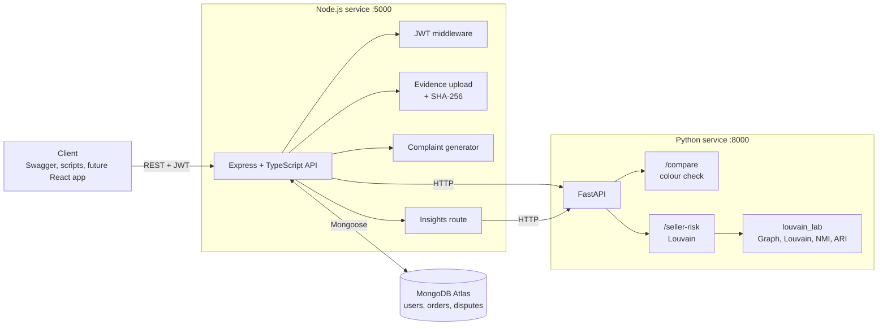
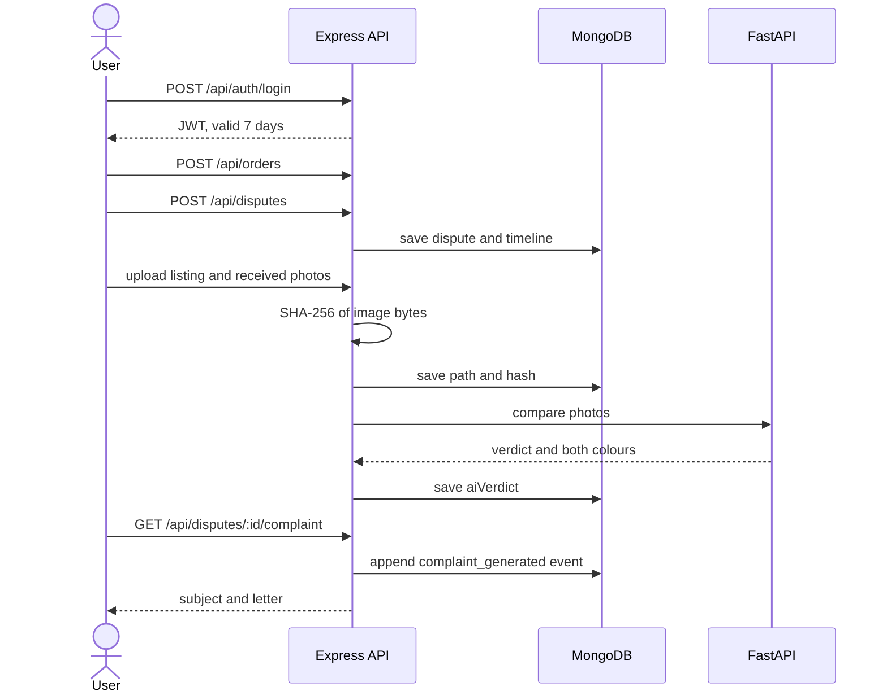
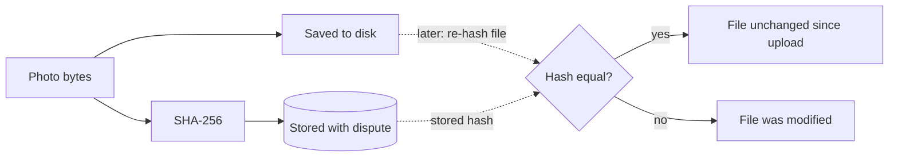
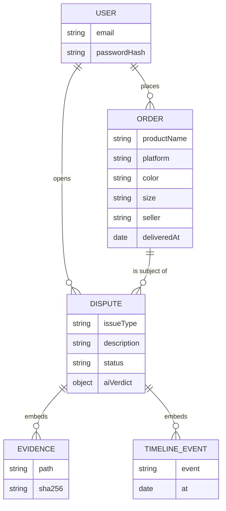
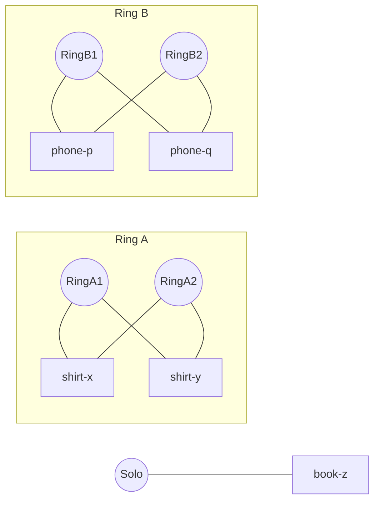
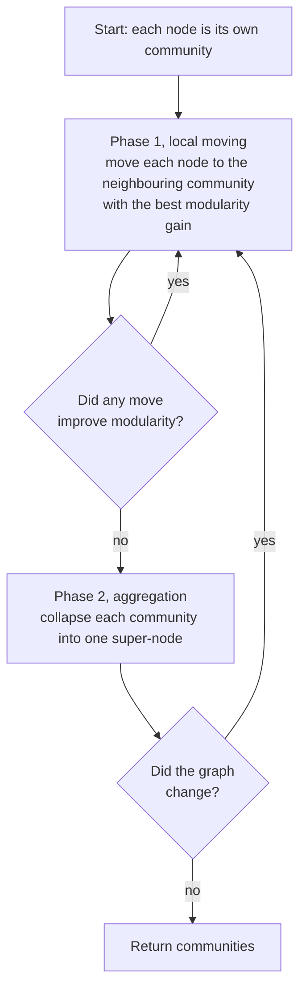
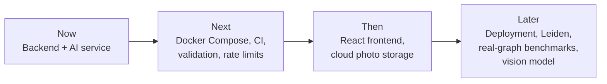

<div align="center">

# 🛒 WrongItem

### Shopping-dispute assistant with tamper-evident evidence and seller-ring detection

*Ordered a blue shirt, got a black one? WrongItem helps you prove it, write the complaint, and see whether the seller is a repeat offender.*


</div>

---

## 📑 Contents

1. [Overview](#-overview)
2. [Highlights](#-highlights)
3. [Tech stack](#-tech-stack)
4. [Architecture](#-architecture)
5. [Key design decisions](#-key-design-decisions)
6. [The Louvain engine](#-the-louvain-engine)
7. [Benchmark results](#-benchmark-results)
8. [API reference](#-api-reference)
9. [Getting started](#-getting-started)
10. [Testing](#-testing)
11. [Security notes](#-security-notes)
12. [Limitations and drawbacks](#-limitations-and-drawbacks)
13. [Future work and implications](#-future-work-and-implications)
14. [What I learned](#-what-i-learned)
15. [Author](#-author)

---

## 🔎 Overview

Online-shopping disputes are slow and one-sided. A buyer has no proof that holds up, writes the complaint from scratch, and cannot tell whether the same seller has wronged others.

WrongItem addresses three problems:

| Problem | What WrongItem does |
|---|---|
| "Can I prove what I received?" | Stores each photo with a **SHA-256 fingerprint** taken at upload, so later edits are detectable |
| "What do I even write?" | Generates a **ready-to-send complaint** from the order, issue, AI verdict and evidence hashes |
| "Is this seller a pattern?" | Builds a **seller-product graph** from disputes and runs **Louvain community detection** to surface linked clusters |

> **Status:** the backend and AI service are complete and tested locally. There is no frontend yet. The AI service documents itself at `/docs` (Swagger UI).

---

## ✨ Highlights

- 🔐 **JWT auth** with bcrypt-hashed passwords; every query is scoped to the logged-in user
- 🧾 **Tamper-evident evidence** using server-side SHA-256 hashing
- 🎨 **Photo-mismatch check** (dominant colour comparison) served by a Python microservice
- ✉️ **Deterministic complaint generator**: no paid AI, same input gives the same output
- 🕸️ **Louvain implemented from scratch** (no graph library), with 4 variants benchmarked on **540 synthetic graphs / 2,160 runs**
- 🧪 **11 pytest regression tests** covering edge cases and reproducibility
- 🧱 **Two independent services**: the API stays up and returns `502` if the AI service is down

---

## 🧰 Tech stack

| Layer | Technology | Why it was chosen |
|---|---|---|
| API | **Node.js 22, Express, TypeScript** | Typed REST layer, fast to iterate |
| Database | **MongoDB Atlas + Mongoose** | Disputes naturally embed evidence and a timeline |
| AI service | **Python, FastAPI, Uvicorn** | Auto-generated OpenAPI docs, async, simple validation |
| Image analysis | **Pillow, NumPy** | Pixel binning and colour maths |
| Graph algorithms | **Pure Python** (adjacency dicts) | Full control over the algorithm; nothing hidden in a library |
| Auth | **JWT, bcrypt** | Stateless sessions, hashed credentials |
| Uploads | **Multer (local disk)** | Simple for development |
| Testing | **pytest**, scripted API tests with `tsx` | Regression tests for the algorithm, smoke tests for routes |
| Dev tooling | **tsx, Git** | Fast TypeScript runs and restarts |

---

## 🏗️ Architecture

### System overview



### Request flow: from login to complaint



### Evidence integrity



> The hash proves a file **has not changed since upload**. It does not prove the photo was genuine before it was uploaded (see [Limitations](#-limitations-and-drawbacks)).

### Data model



Evidence and timeline are **embedded** (one read returns the whole dispute). Orders are **referenced**, because several disputes can point to one order.

### From disputes to a graph

Each dispute links a seller to a product. Louvain then looks for dense groups.



Real output from `test-insights.ts` on this exact data:

```json
[
  { "id": 1, "sellers": ["RingA1", "RingA2"], "products": ["shirt-x", "shirt-y"], "total_complaints": 4 },
  { "id": 2, "sellers": ["RingB1", "RingB2"], "products": ["phone-p", "phone-q"], "total_complaints": 4 },
  { "id": 0, "sellers": ["TestSeller"],       "products": ["Blue Cotton Shirt"],  "total_complaints": 2 },
  { "id": 3, "sellers": ["Solo"],             "products": ["book-z"],             "total_complaints": 1 }
]
```

---

## 🧭 Key design decisions

| Decision | Alternative | Reasoning | Trade-off |
|---|---|---|---|
| Two services (Node + Python) | One Node service | Graph and image work is simplest in Python; services can be tested and scaled separately | Extra network hop and one more thing to run |
| Louvain from scratch | `networkx` / `python-louvain` | Needed to understand and modify the algorithm, and to benchmark variants | More code to maintain; less battle-tested |
| Embedded evidence and timeline | Separate collections | One read returns the full dispute | Large disputes grow one document |
| Template-based complaint | LLM generation | Deterministic, free, testable | Less natural phrasing |
| Colour-based photo check | Vision model | Explainable baseline, no API cost | Weak on patterns and lighting |
| Fail with `502` on AI outage | Silent fallback | The API says plainly what failed | The verdict is unavailable until the service is back |
| Benchmark against planted rings | Modularity only | Ground truth allows NMI and ARI | Synthetic data may not match real fraud patterns |

---

## 🧠 The Louvain engine

Located in `ai-service/louvain_lab`. Written without graph libraries: `Graph` (adjacency dictionaries), `Louvain`, modularity, NMI and ARI.

**Modularity** measures how much denser the edges inside groups are than random chance predicts. Louvain maximises it greedily:



### Variants compared

| Variant | Idea | Outcome |
|---|---|---|
| **Baseline** | Standard Louvain | Reference |
| **Degree-ordered** | Visit nodes by degree instead of arbitrary order | Tied with baseline |
| **Connectivity repair** | Split any community that is not internally connected | Never triggered (0 disconnected communities in all runs) |
| **Multi-start** | 10 runs with different seeds, keep best modularity | Helped at easy and medium noise; about 10× the runtime |

### Evaluation method

- **540 graphs** = 6 difficulty levels × 90 graphs, 76 nodes each
- **7 planted seller rings** per graph with uneven sizes, so the true answer is known
- **4 variants → 2,160 runs**
- Scored with **NMI** and **ARI** against the planted rings, not only modularity
- Raw output: [`ai-service/results.csv`](ai-service/results.csv)

---

## 📊 Benchmark results

| Level | NMI baseline | NMI multi-start | ARI baseline | ARI multi-start |
|---|---|---|---|---|
| easy | 0.8931 | 0.9036 | 0.8663 | 0.8827 |
| **medium** | 0.6026 | **0.6380** | 0.5085 | **0.5608** |
| hard | 0.3362 | 0.3373 | 0.1577 | 0.1625 |
| sparse | 0.2227 | 0.2176 | 0.0505 | 0.0542 |
| sparser | 0.1736 | 0.1792 | 0.0132 | 0.0167 |
| noisy | 0.1548 | 0.1517 | 0.0016 | 0.0025 |

ARI by difficulty (`▓` baseline, `█` multi-start):

```
easy     ▓▓▓▓▓▓▓▓▓▓▓▓▓▓▓▓▓▓▓▓▓▓▓▓▓▓▓▓▓▓▓▓▓▓▓▓▓▓▓  0.866
         ███████████████████████████████████████████  0.883
medium   ▓▓▓▓▓▓▓▓▓▓▓▓▓▓▓▓▓▓▓▓▓▓▓▓▓  0.509
         ████████████████████████████  0.561
hard     ▓▓▓▓▓▓▓▓  0.158
         ████████  0.163
sparse   ▓▓▓  0.051
         ███  0.054
sparser  ▓  0.013
         █  0.017
noisy    ▏ 0.002
         ▏ 0.003
```

### What the numbers say

- ✅ **Multi-start helps most at medium noise** (ARI 0.51 → 0.56, NMI 0.60 → 0.64).
- ⚠️ **On the hardest graphs the gain is negligible**, and NMI is slightly lower in two rows.
- 📉 **Recovery collapses as noise rises** (NMI about 0.89 → 0.15). That marks where planted rings stop being detectable.
- ⚠️ **Connectivity repair and degree ordering gave no measurable benefit**, so no benefit is claimed.
- 🔬 **No significance test was run.** Only the medium-level gain is large enough to rely on.
- 💸 Multi-start costs roughly 10× the runtime.

---

## 🔌 API reference

### Node API (`:5000`)

| Method | Endpoint | Auth | Purpose |
|---|---|---|---|
| POST | `/api/auth/login` | – | Returns a JWT |
| POST | `/api/orders` | ✅ | Create an order |
| POST | `/api/disputes` | ✅ | Open a dispute for an order |
| GET | `/api/disputes/:id/complaint` | ✅ | Generate subject and body of the complaint |
| GET | `/api/insights/seller-risk` | ✅ | Louvain clusters of sellers and products |

Registration, evidence upload, verdict and status-change routes are in `backend/src/routes/`.

### Python AI service (`:8000`)

| Method | Endpoint | Purpose |
|---|---|---|
| POST | `/compare` | Compare dominant colours of listing and received photos |
| POST | `/seller-risk` | Cluster `{seller, product, count}` rows with Louvain |
| GET | `/docs` | Interactive Swagger UI |

### Example: complaint output

```
SUBJECT: Request for replacement/refund: Blue Cotton Shirt

Dear Support Team,

I am writing about my order of "Blue Cotton Shirt" on Flipkart.
I received a different item from the one I ordered.
Details: Ordered blue, received black

Order details:
- Product: Blue Cotton Shirt
- Ordered colour: Blue
- Size: M
- Seller: TestSeller
...
```

When a verdict and photos exist, the letter also includes the colour comparison and the SHA-256 fingerprints.

---

## 🚀 Getting started

**Prerequisites:** Node.js 22, Python 3.11+, a MongoDB Atlas connection string.

### 1. AI service

```bash
cd ai-service
python -m pip install -r requirements.txt
python -m uvicorn main:app --reload --port 8000
```

### 2. Backend

```bash
cd backend
cp .env.example .env        # Windows PowerShell: copy .env.example .env
npm install
npm run dev
```

Wait for `MongoDB connected` and `Backend running on port 5000`.

### 3. Environment variables

```
PORT=5000
MONGO_URI=your-mongodb-connection-string
JWT_SECRET=change-me
AI_SERVICE_URL=http://localhost:8000
```

### 4. Try it

```bash
cd backend
npx tsx test-verdict.ts      # blue vs black → mismatch, blue vs blue → match
npx tsx test-complaint.ts    # prints a generated complaint
npx tsx test-insights.ts     # prints Louvain seller clusters
```

---

## 🧪 Testing

**Algorithm (pytest):**

```bash
cd ai-service
python -m pytest -v
```

11 regression tests: known graph, every node in exactly one community, seed reproducibility, empty graph, single node, self-loop, disconnected graph, repair step, modularity range, multi-start, metrics.

**API:** scripted flows in `backend/test-*.ts` (auth, disputes, upload, verdict, complaint, insights). These are smoke tests, not a full automated suite.

---

## 🔒 Security notes

| Area | Current state |
|---|---|
| Passwords | Hashed with bcrypt; never stored in plain text |
| Sessions | JWT, 7-day expiry, checked by middleware on protected routes |
| Authorization | Dispute queries filter by the logged-in user's ID |
| Secrets | `.env` is git-ignored; only `.env.example` is committed |
| Evidence | SHA-256 recorded at upload |
| Database access | Atlas allow-list is `0.0.0.0/0` **for development only**; production should use fixed IPs or private networking |
| Not yet done | Input validation, rate limiting, file-type and size limits, refresh tokens |

---

## ⚠️ Limitations and drawbacks

Stated plainly, so nobody has to find them the hard way.

**Algorithm and data**
- The 540 benchmark graphs are **synthetic and small** (76 nodes). Results may not transfer to real dispute data.
- No **statistical test** across seeds; only the medium-level gain is large enough to quote.
- Louvain has known weaknesses: the **resolution limit**, **node-order sensitivity**, and occasional disconnected communities (the problem Leiden was designed to fix). None of this has been compared against Leiden yet.
- Multi-start improves modularity by construction, so modularity gain alone is weak evidence; NMI and ARI are the real measure.

**Photo check**
- Compares **dominant colour only**. Patterns, shadows, lighting and multi-colour items can fool it.
- It has not been tested on a labelled image set, so there is no accuracy figure.
- The result is a **suggestion** that the user confirms.

**Evidence**
- A hash shows a file is unchanged **after upload**, not that it was genuine **before**. A stronger design adds a trusted timestamp and capture metadata.
- Photos are stored on **local disk**, which does not scale or survive a server move.

**Seller-risk view**
- Seller names come from **user input**, so false or mistyped reports could unfairly flag a seller.
- Any logged-in user can see cross-user seller clusters. A real product needs moderation, minimum thresholds and an appeal process before anything is shown publicly.

**Engineering**
- **No frontend**, no Docker, no CI, no deployment.
- Limited input validation, no rate limiting, no pagination.
- API tests are scripts, not an automated suite.
- Escalation contacts in the complaint text (grievance officer, helpline) must be **re-verified** against official consumer-affairs sites before real use.

---

## 🔭 Future work and implications

### Roadmap



| Priority | Item | Why it matters |
|---|---|---|
| High | GitHub Actions CI running pytest and API tests | Catches regressions automatically |
| High | Input validation (Zod), rate limiting, pagination | Closes the main API hardening gaps |
| High | Docker Compose for both services plus Mongo | One-command setup |
| Medium | React + Vite frontend | Turns the API into a usable product |
| Medium | S3 / Cloudinary for photos | Removes the local-disk limit |
| Medium | Label a photo set and measure colour-check accuracy | Replaces a guess with a number |
| Medium | Compare against **Leiden**, run on **real graph datasets**, add significance tests | Strengthens the research side |
| Low | Vision model (e.g. CLIP) for item matching | Handles patterns and product type, not only colour |
| Low | Trusted timestamping of evidence hashes | Stronger proof for disputes |
| Low | Deployment with monitoring | A live demo link |

### Why this could matter

- **For consumers:** a repeatable way to document a dispute with evidence that is hard to dispute afterwards.
- **For platforms and regulators:** seller clustering can highlight coordinated or repeat problem sellers early, provided it is paired with thresholds and human review.
- **For graph research:** the benchmark setup (planted rings, uneven sizes, graded noise, NMI/ARI scoring) is reusable for testing other community-detection variants.

Any real deployment would need privacy review, fair treatment of sellers, and legal checks on the complaint templates.

---

## 📚 What I learned

- **Pin toolchain versions.** `ts-node-dev` crashed because npm pulled TypeScript 7, which removed an API it depends on. Pinning TypeScript 5 and switching to `tsx` fixed it.
- **Cloud databases and changing networks.** MongoDB Atlas rejected connections when my IP changed. I allowed `0.0.0.0/0` for development and documented the production alternative.
- **Don't force a result.** The first benchmark graphs were too clean, so every variant tied. I made them harder and reported the honest outcome: only multi-start helped, and only partly.
- **Evaluate against ground truth.** Planted rings let me score with NMI and ARI instead of trusting modularity.
- **Say what a feature does not prove.** A hash shows integrity, not authenticity.

---

## 👤 Author

**Vishal Mundewadi**

[GitHub](https://github.com/vishal-mundewadi) · [LinkedIn](https://www.linkedin.com/in/YOUR_PROFILE)

<sub>Built as a personal project. Benchmark data is synthetic.</sub>
